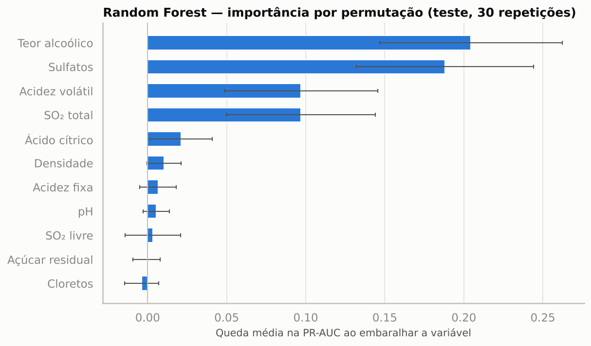

# Classificação da qualidade de vinhos com Machine Learning

**Tech Challenge — Fase 2 · PósTech Data Analytics (FIAP)**

Modelo que prevê se um vinho tinto é de **alta qualidade (nota ≥ 7)** ou **baixa/média (nota < 7)** a partir de
11 medições físico-químicas de laboratório. O projeto também identifica **quais características mais pesam na
qualidade** e o que isso significa para o processo de produção.

## Integrantes do grupo

| Nome | RM |
|---|---|
| Igor S. U. Ramalho | 376886 |
| Luana L. Reis | 376811 |
| Rafaele T. Lima | 376318 |
| Thiago S. do Nascimento | 376102 |

## Entregáveis

| Entregável | Onde está |
|---|---|
| Código e análises | [`notebooks/01_eda.ipynb`](notebooks/01_eda.ipynb) (problema + EDA) e [`notebooks/02_modelagem.ipynb`](notebooks/02_modelagem.ipynb) (pré-processamento, modelos, avaliação e interpretação) |
| Apresentação executiva (storytelling da EDA) | [`presentation/apresentacao_executiva.pdf`](presentation/apresentacao_executiva.pdf) |
| Relatório técnico-executivo (execução e resultados por etapa) | [`presentation/relatorio_o_que_faz_um_vinho_ser_excelente.pdf`](presentation/relatorio_o_que_faz_um_vinho_ser_excelente.pdf) |
| Vídeo executivo (até 5 min) | [Assistir no Google Drive](https://drive.google.com/drive/folders/1o9byD_f4ciEEFs4sd_V8rF8rkbu-qmiy) |
| Gráficos e métricas | [`results/`](results/) |

---

## Resultados em resumo

| | |
|---|---|
| **Base** | 1.143 amostras de vinho tinto → **1.018 únicas** após remover 125 linhas repetidas |
| **Alvo** | 137 vinhos de alta qualidade (**13,5%**) — classes desbalanceadas |
| **Modelos comparados** | Regressão Logística, KNN, SVM, Árvore de Decisão e Random Forest |
| **Modelo final** | **Random Forest** (limiar de decisão 0,43, escolhido no treino) |
| **Desempenho no teste** | ROC-AUC **0,91** · PR-AUC **0,69** · F1 **0,56** · recall **0,70** · precisão **0,46** |
| **Validação cruzada (5×3)** | F1 0,54 ± 0,07 · ROC-AUC 0,88 |
| **O que mais influencia** | **Teor alcoólico (+)**, **sulfatos (+)** e **acidez volátil (−)**; depois SO₂ total (−) |

**Em linguagem de negócio:** dos 204 vinhos do teste, o modelo apontou 41 como "alta qualidade" e **19 deles
realmente eram** — 46% de acerto, contra 13% se a escolha fosse ao acaso. Esses 41 vinhos (20% do total)
concentram **70% dos vinhos bons**. Na prática, o modelo serve como **triagem**: indica quais lotes merecem
prioridade na prova sensorial e quais têm risco de qualidade baixa.

**Onde o modelo erra:** quase sempre na fronteira do corte. Dos 22 alarmes falsos, 19 são vinhos de nota 6, e os 8
vinhos bons não encontrados têm nota 7; só 3% dos vinhos de nota 5 são apontados como "alta". Por isso o modelo serve
para triagem, mas não para decidir sozinho o selo premium (análise completa na seção 7.1 do notebook 02).



---

## O problema

A avaliação de vinhos por especialistas é subjetiva, demorada e depende da experiência dos avaliadores. As
medições químicas, porém, já são feitas durante a produção. A pergunta de negócio é:

> *Com as medições de laboratório, conseguimos antecipar se um lote tende a ser de alta qualidade — e saber
> quais características ajustar no processo?*

Problema de **classificação binária supervisionada**. A métrica principal é o **F1 da classe "alta qualidade"**,
porque os dois erros custam caro (vender como premium um vinho comum x deixar de identificar um vinho bom) e porque
a acurácia engana: um modelo que sempre responde "baixa/média" acerta 86,5% e não encontra nenhum vinho bom.

## Os dados

**Wine Quality Dataset** (Kaggle, arquivo `WineQT.csv`), com amostras de vinho tinto português "Vinho Verde"
originalmente publicadas por Cortez et al. (2009) no repositório UCI.

| Variável | Descrição |
|---|---|
| `fixed acidity` | Acidez fixa (ácidos não voláteis) |
| `volatile acidity` | Acidez volátil (ácido acético — em excesso, gosto de vinagre) |
| `citric acid` | Ácido cítrico |
| `residual sugar` | Açúcar residual |
| `chlorides` | Cloretos (sal) |
| `free sulfur dioxide` | SO₂ livre |
| `total sulfur dioxide` | SO₂ total |
| `density` | Densidade |
| `pH` | pH |
| `sulphates` | Sulfatos |
| `alcohol` | Teor alcoólico |
| `quality` | Nota dos especialistas (origem do alvo) |
| `Id` | Identificador da linha (removido) |

## Principais achados da análise exploratória

1. **Desbalanceamento:** só 1 em cada 7 vinhos é de alta qualidade.
2. **Dados limpos, mas com repetições:** sem nulos e sem valores inconsistentes; `Id` sem valor analítico; **10,9% de linhas idênticas**
   (mesma química e mesma nota), removidas para evitar peso duplo e vazamento entre treino e teste.
3. **O vinho de alta qualidade típico** tem mais álcool (mediana 11,7% vs 10,0%), menos acidez volátil
   (0,36 vs 0,55 g/dm³), mais sulfatos (0,74 vs 0,60) e mais ácido cítrico (0,40 vs 0,24).
4. **Nenhuma variável separa as classes sozinha:** a maior correlação com a nota é a do álcool (r = +0,49).
5. **Diferenças comprovadas estatisticamente:** Shapiro-Wilk rejeita a normalidade → teste de Mann-Whitney U;
   8 de 11 variáveis diferem entre as classes mesmo com correção de Bonferroni, com efeito grande para álcool e
   acidez volátil e no limite de grande para sulfatos.
6. **Outliers reais e informativos** (cloretos, açúcar, sulfatos): mantidos e suavizados com log1p.
7. **Correlações entre variáveis justificadas pela química:** acidez fixa × pH (−0,69), acidez fixa × densidade
   (+0,68), SO₂ livre × total (+0,66), densidade × álcool (−0,50) etc. (tabela completa no notebook 01).

## Metodologia

1. **Divisão** 80/20 estratificada (o teste fica guardado até o fim).
2. **Pré-processamento dentro de um `Pipeline`** (ajustado só no treino, sem vazamento):
   variáveis derivadas (acidez total, proporção SO₂ livre/total, SO₂ combinado, álcool × sulfatos) →
   log1p nas variáveis assimétricas → `StandardScaler` → tratamento do desbalanceamento
   (`class_weight="balanced"` ou oversampling só no treino, no caso do KNN).
3. **Linha de base** com `DummyClassifier` para mostrar o problema da acurácia.
4. **Cinco modelos** ajustados com `GridSearchCV` + `StratifiedKFold` (5 dobras), escolhendo hiperparâmetros
   pelo F1.
5. **Comparação robusta** com validação cruzada repetida (5 dobras × 3 repetições).
6. **Avaliação no teste** com matriz de confusão, classification report, curvas ROC e Precisão-Recall.
7. **Limiar de decisão** escolhido no treino (probabilidades fora da dobra), nunca no teste.
8. **Interpretação** com importância por permutação, coeficientes da Regressão Logística e uma árvore rasa
   com regras legíveis.

### Comparação dos modelos

| Modelo | F1 (CV 5×3) | ROC-AUC (CV) | PR-AUC (CV) |
|---|---|---|---|
| **Random Forest** | **0,54 ± 0,07** | 0,88 | **0,59** |
| SVM (kernel RBF) | 0,53 ± 0,07 | 0,87 | 0,56 |
| Regressão Logística | 0,52 ± 0,06 | **0,89** | 0,58 |
| KNN | 0,49 ± 0,06 | 0,87 | 0,55 |
| Árvore de Decisão | 0,47 ± 0,06 | 0,79 | 0,41 |
| *Linha de base (sorteio)* | *0,10* | — | — |

Random Forest, SVM e Regressão Logística são estatisticamente próximos. A Random Forest foi escolhida pelo melhor
desempenho médio e pela melhor capacidade de ordenar os vinhos no teste; a Regressão Logística é usada como modelo
explicativo (coeficientes).

## Implicações para a produção

| Achado | Ação sugerida (hipótese a validar com o enólogo) |
|---|---|
| Acidez volátil alta é o principal sinal negativo | Controle de higiene, temperatura e oxigênio na fermentação; monitorar o ácido acético (corte encontrado: ~0,4 g/dm³) |
| Mais álcool → mais chance de alta qualidade | Ponto de colheita (maturação) e fermentação completa — não "adicionar álcool" |
| Sulfatos mais altos favorecem a qualidade | Revisar o protocolo de conservação; o efeito satura |
| SO₂ total e cloretos altos aparecem nos vinhos comuns | Evitar excesso de conservante; investigar a origem dos sais |
| Modelo com ROC-AUC ≈ 0,9 | Usar como triagem de laboratório para priorizar a prova sensorial — apoio, não substituto do especialista |

**Limitações:** base pequena (27 vinhos de alta qualidade no teste), apenas vinho tinto de uma região, alvo
subjetivo e ausência de variáveis como casta, safra e tempo de barrica. Os resultados mostram associação, não
causa.

---

## Estrutura do repositório

```
postech15dtat-tech-challenge-2-wine/
├── data/
│   └── WineQT.csv                  # base original do Kaggle
├── notebooks/
│   ├── 01_eda.ipynb                # compreensão do problema + análise exploratória
│   └── 02_modelagem.ipynb          # pré-processamento, modelos, avaliação e interpretação
├── src/                            # funções reutilizáveis usadas pelos notebooks
│   ├── config.py                   # caminhos, constantes e rótulos em português
│   ├── data.py                     # carga, padronização, alvo e duplicatas
│   ├── preprocessing.py            # feature engineering, log, outliers, scaler
│   ├── modeling.py                 # modelos, grades de hiperparâmetros e GridSearchCV
│   ├── evaluation.py               # métricas, limiar e tabelas de trade-off
│   └── visualization.py            # padrão visual e gráficos
├── results/
│   ├── figures/                    # todos os gráficos (PNG)
│   └── *.csv                       # métricas e tabelas da análise
├── presentation/
│   ├── apresentacao_executiva.pdf  # apresentação executiva (storytelling da análise)
│   └── relatorio_o_que_faz_um_vinho_ser_excelente.pdf  # relatório técnico-executivo por etapa
├── requirements.txt
└── README.md
```

## Como executar

### Google Colab (recomendado)
1. Abra o notebook direto no Colab:
   - [01_eda.ipynb no Colab](https://colab.research.google.com/github/igorsycko/postech15dtat-tech-challenge-2-wine/blob/main/notebooks/01_eda.ipynb)
   - [02_modelagem.ipynb no Colab](https://colab.research.google.com/github/igorsycko/postech15dtat-tech-challenge-2-wine/blob/main/notebooks/02_modelagem.ipynb)
2. Execute `Runtime > Run all` (`Ambiente de execução > Executar tudo`). A primeira célula clona o repositório,
   instala as dependências e ajusta os caminhos automaticamente.

Rode primeiro o `01_eda.ipynb` e depois o `02_modelagem.ipynb` (o 02 leva ~2 a 4 minutos no Colab).

### Localmente
Requer Python 3.11 ou superior.
```bash
git clone https://github.com/igorsycko/postech15dtat-tech-challenge-2-wine.git
cd postech15dtat-tech-challenge-2-wine
python -m venv venv
venv\Scripts\activate          # Windows  (Linux/macOS: source venv/bin/activate)
pip install -r requirements.txt jupyter
jupyter notebook notebooks/
```

Todos os resultados são reprodutíveis: semente fixa (`random_state = 42`) e versões do scikit-learn e do
imbalanced-learn fixadas no `requirements.txt`, porque a Random Forest muda levemente entre versões da biblioteca.

## Tecnologias

Python · pandas · NumPy · SciPy · scikit-learn · imbalanced-learn · Matplotlib · Seaborn · Google Colab

## Referência dos dados

Cortez, P.; Cerdeira, A.; Almeida, F.; Matos, T.; Reis, J. *Modeling wine preferences by data mining from
physicochemical properties.* Decision Support Systems, 47(4), 547–553, 2009.

---

**Tech Challenge Fase 2** — PósTech Data Analytics, FIAP
